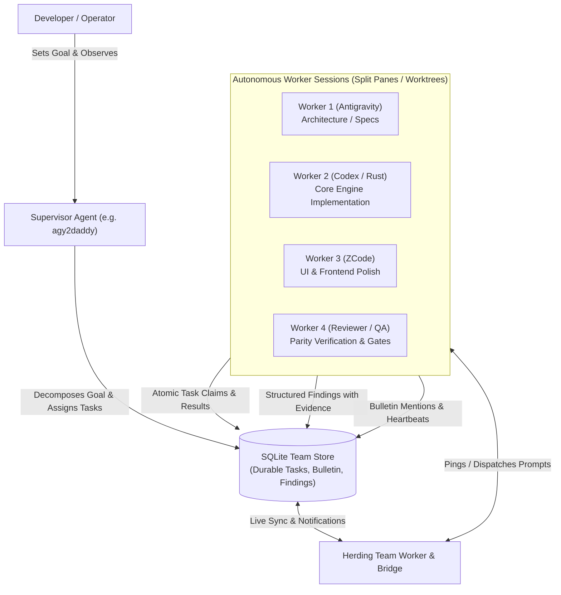

<p align="center">
  
</p>

<h1 align="center">Herding</h1>

<p align="center">
  <b>Multi-Agent Orchestration &amp; Autonomous Team Coordination for GPUI</b>
</p>

<p align="center">
  <a href="https://github.com/penso/herdr-gpui/actions/workflows/ci.yml"></a>
</p>

<p align="center">
  <a href="docs/herding-spec.md"><b>Architecture Spec</b></a> ·
  <a href="docs/herding-playbook.md">Backlog Playbook</a> ·
  <a href="docs/herding-roadmap.md">Roadmap</a> ·
  <a href="docs/cli.md#team-coordination">Team CLI</a> ·
  <a href="docs/herding-handoff.md">Implementation Handoff</a> ·
  <a href="docs/herding-review-notes.md">Review Notes</a> ·
  <a href="#upstream-herdr-ui-reference">Upstream Herdr UI Reference</a>
</p>

Herding transforms your terminal workspaces into an autonomous multi-agent engineering team. Instead of manually copying prompts and diffs across disjoint terminal windows, Herding runs directly on top of your local daemon panes and Git worktrees. A designated supervisor agent breaks goals down into discrete, bounded tasks, assigns them across worker sessions (running Antigravity, Codex, OpenCode, Claude Code, or ZCode), and coordinates the entire workflow through a durable bulletin, task board, and findings ledger.

> **Unaffiliated project.** Built on top of the native Rust/GPUI client for the [Herdr](https://herdr.dev/) daemon. Not affiliated with, endorsed by, or supported by Herdr or herdr.dev.

---

## Architecture: How Herding Works



### Core Tenets

1. **Autonomous Supervisor / Worker Division**: The supervisor plans, unblocks, reviews, and synthesizes. Workers claim individual tasks atomically, execute them in isolated worktrees or shared trees, verify their changes, and report back verifiable evidence.
2. **Durable Local State (SQLite)**: Teams, message bulletins, task lifecycles, and findings are stored locally in an embedded SQLite database. If a session crashes, the network disconnects, or the UI restarts, team state is never lost.
3. **Delivery Honesty & Anti-Spam**: Delivering a prompt notification to an agent pane does not mean the agent read or accepted it. The bulletin records message delivery and acknowledgement status separately. Broadcast spam is strictly rejected: @mentions route prompts solely to the intended recipients.
4. **Harness Agnostic**: Herding treats any CLI agent harness as a first-class citizen. Antigravity (`agy`), OpenAI Codex (`codex`), OpenCode, Claude Code, and ZCode operate together in the same team roster.
5. **Real Pane Grounding**: Every member on the roster is bound to a real, inspectable terminal pane in Herdr. Clicking a worker in the UI immediately focuses that agent's actual terminal session.

---

## Key Features

### 1. Unified Team Workspace
The native GPUI workspace combines:
- **Live Team Roster**: Active supervisor and workers with live harness indicators (`agy`, `codex`, `opencode`, `claude`, `zcode`), connection status, and direct pane focus.
- **Task Board**: Real-time status columns (`open`, `in_progress`, `blocked`, `done`, `cancelled`) with atomic claim semantics, assignee tracking, and blocker reason disclosure.
- **Findings Ledger**: Structured technical discoveries, regressions, and audit findings categorized by confidence level (`high`, `medium`, `low`) with attached code evidence and reproduction steps.
- **Team Bulletin**: A persistent, searchable message feed with threaded replies, @mention dispatch, unread tracking, and delivery receipts.

### 2. Multi-Agent CLI Coordination
Agents drive team state directly from their own panes using the `herdr-gpui team` CLI:

```bash
# Check team status, active goal, and roster
herdr-gpui team status <TEAM_ID>

# Claim an assigned task
herdr-gpui team task claim <TEAM_ID> <TASK_ID>

# Post an update or mention an agent on the bulletin
herdr-gpui team bulletin post <TEAM_ID> --reply-to <MSG_ID> "@daddy Task verified with cargo test"

# Record an empirical discovery or regression finding
herdr-gpui team finding add <TEAM_ID> \
  --title "Lock contention in status cache" \
  --confidence high \
  --description "Found 350ms p95 latency under 10 concurrent requests"

# Mark a task complete with verifiable results
herdr-gpui team task complete <TEAM_ID> <TASK_ID> --result "206 tests passed; clean clippy"
```

### 3. Agent Heartbeats & PTO Liveliness Monitoring
When running multi-agent swarms, workers inevitably run into provider rate limits (Anthropic 5-hour limits, OpenAI 429s, Gemini `RESOURCE_EXHAUSTED`, ZCode usage caps) or crash.

Herding includes an automated supervisor heartbeat tool (`scripts/herding-heartbeat.py`) that:
- Inspects pane scrollback for provider quota exhaustion and error signatures.
- Classifies agent health states: `RESPONSIVE`, `BUSY`, `PTO` (on paid time off / rate-limited), `STALLED`, or `DISCONNECTED`.
- Measures ping round-trip latency.
- Emits automatic task failover and reassignment recommendations to keep the pipeline moving.

---

## Roadmap & Active Milestones

Herding is under rapid iterative development. Track active progress and architecture milestones in [docs/herding-roadmap.md](docs/herding-roadmap.md):

- **Milestone 5.1 (Current)**: Durable SQLite team state, real-time bulletin, atomic task lifecycle, and GPUI team view.
- **Milestone 5.2**: Specialized agent role presets (`architect`, `implementer`, `reviewer`, `researcher`, `debugger`) and automated protocol handoffs.
- **Milestone 5.3**: Cursor-based backward pagination for large boards (>1,000 tasks and bulletins).
- **Milestone 5.4**: Git worktree automation with per-worker isolated checkouts and automatic cargo build cache sharing (`docs/build-cache.md`).
- **Milestone 5.5**: Multi-host fleet coordination over Tailscale and SSH remote bridges.

For known limitations and active review audits, consult [docs/herding-review-notes.md](docs/herding-review-notes.md).

---

## Quickstart & Installation

Install the [Herdr](https://herdr.dev/) daemon first, then install the Herdr GPUI client:

| Platform | Command |
| --- | --- |
| macOS | `brew install penso/tap/herdr-gpui` |
| Linux (APT, DNF or pacman) | `curl -fsSL https://herdrui.dev/install.sh \| sh` |
| Windows (PowerShell) | `irm https://herdrui.dev/install.ps1 \| iex` |

### Building from Source

```bash
git clone https://github.com/penso/herdr-gpui.git
cd herdr-gpui

# Release build with GPUI native terminal and Herding features
cargo run --locked --release -p herdr-gpui
```

---

## Upstream Herdr UI Reference

Herding is built on top of **Herdr UI**, the high-performance native GPUI client for the Herdr terminal multiplexing daemon.

### Terminal & Multiplexing Capabilities
- **Native GPUI Painting**: Paints daemon terminal cells and split panes directly via GPU shaders without wrapping an embedded terminal emulator.
- **Workspaces & Git Worktrees**: Manage isolated branches, checkouts, and terminal sessions from a unified sidebar.
- **Teleport**: Move an entire working tree over SSH to another host with its uncommitted diffs, splits, and running processes intact.
- **Visual Diff Review**: Review changes side-by-side or unified, click lines to leave comments, and dispatch feedback directly to agent panes.
- **Integrated Browser & Annotations**: Open pages via `herdr-gpui browser open`, capture element screenshots, annotate DOM targets, and pass feedback to coding agents.
- **Extensive Theming**: Light and dark system adaptation, Catppuccin, Ghostty themes, and native layout customizers.

For upstream terminal configuration, keybindings, and platform specifics:
- [GUI Scope & Configuration](crates/herdr-gpui/README.md)
- [Command Line Interface (CLI)](docs/cli.md)
- [Performance Benchmarks](crates/herdr-gpui/PERFORMANCE.md)
- [Usage Providers & Plan Limits](docs/usage-providers.md)
- [Contributing & Agent Playbook](AGENTS.md)

### License
Apache-2.0. See [LICENSE](LICENSE) and [NOTICE](NOTICE).
