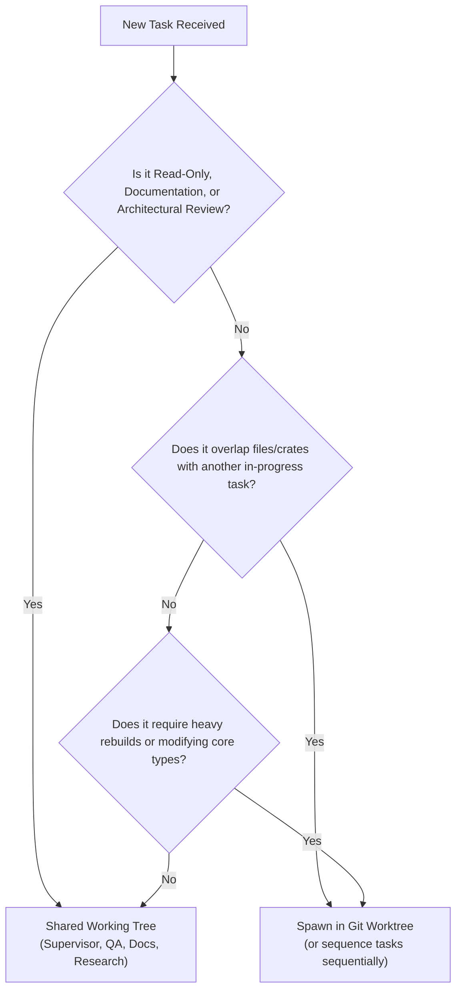

# Workspace Isolation Policy: Shared Working Tree vs. Git Worktrees

Guidelines for Herding supervisors, developers, and autonomous agents when deciding between working in the primary working tree or spawning isolated Git worktrees.

## Executive Summary
**Not every agent should get their own Git worktree.** 
Workspace isolation is **opt-in and dynamic**, driven by file overlap, compile lock contention, and task granularity. Because Herder's `TeamStore` is centralized in SQLite and indexed by `HERDR_PANE_ID` / `HERDR_WORKSPACE_ID`, all agents coordinate seamlessly on the same Bulletin, Task Board, and Findings regardless of checkout location.

---

## Tradeoff Comparison

| Dimension | Shared Working Tree (Default) | Opt-in Git Worktrees |
| :--- | :--- | :--- |
| **Setup Cost** | Zero friction, instant pane attach | Requires worktree path creation & initial branch setup |
| **Build Cache** | Shared `target/` cache (fast incremental compile) | Separate `target/` directory (duplicate compiles & disk usage) |
| **Concurrency** | Risk of cargo file locks during simultaneous builds | Full isolation; agents run `cargo test` independently |
| **Code Collision** | Mid-edit compiler breaks can affect peers | Zero risk of peer uncommitted edits affecting builds |
| **Best Suited For** | Supervisors, Reviewers, QA, documentation, disjoint crates | Parallel feature implementations, heavy refactors touching shared types |

---

## Supervisor Decision Framework

When decomposing a goal and assigning tasks, the Supervisor uses the following heuristic:

### 1. File Intersection (Overlap Check)
- **Disjoint files or crates:** (e.g. Worker A in `crates/sheprd-orchestrator`, Worker B in `crates/sheprd-gpui/src/team/view/bulletin.rs`, Worker C in `docs/`):
  -> **Shared Working Tree**.
- **Overlapping files:** (e.g. two workers simultaneously modifying `bridge.rs`):
  -> **Git Worktree**, or the supervisor sequences the tasks serially.

### 2. Build & Test Lock Contention
- Heavy iterative testing on the same crate (`cargo test -p sheprd-gpui`) triggers `Blocking waiting for file lock on build directory` if multiple agents run checks concurrently.
- Agents tasked with heavy continuous compilation or benchmark runs should be given an isolated worktree.

### 3. Granularity & Risk
- **Small targeted fixes (1–2 files):** Shared working tree with coordination via the team bulletin.
- **Large architectural refactors / breaking traits:** Dedicated branch in an isolated worktree, merged via clean PR review.
